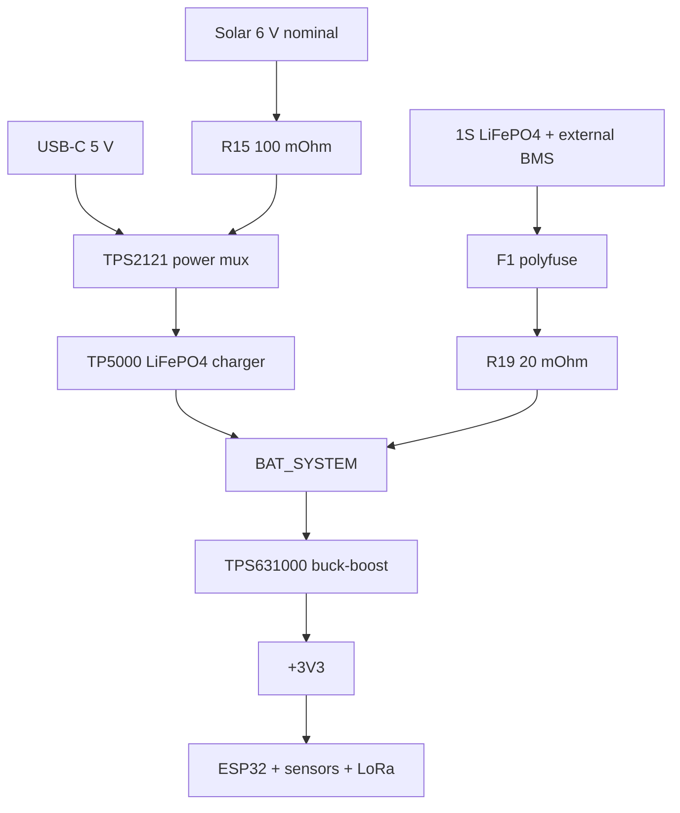

# Meteostation — технічний контекст для перевірки схеми та розводки PCB у Kimi K3

Версія документа: 2026-09-13, component-comments revision v3  
Статус: handoff перед placement/routing  
Ціль: одна PCB метеостанції, описана двома аркушами KiCad

## 0. Як користуватися цим документом

Цей файл треба передати Kimi K3 разом із актуальними файлами:

- `main_board(20260912-224610).kicad_sch` — MCU, LoRa, I²C, RTC, FRAM, INA226, зовнішні інтерфейси;
- `untitled(20260912-224611).kicad_sch` — USB-C, Solar, power mux, зарядний контролер, батарея, buck-boost 3.3 V;
- кореневим `.kicad_sch`, `.kicad_pro`, `.kicad_pcb` та кастомними бібліотеками/footprint-ами, якщо вони зберігаються окремо.

Обидва надані `.kicad_sch` слід трактувати як два аркуші одного виробу, а не як дві незалежні плати. Вони пов’язані global labels і спільними power nets.

### Revision audit 22:46

Порівняно з ревізією 21:59:

- component values, footprints і DNP flags не змінилися;
- набір net/global labels не змінився;
- підтверджене LoRa TX-only wiring збережене;
- додані procurement/layout comments до компонентів;
- додані загальні notes про dielectric, tolerance, TCR, power rating, VNA tuning, outdoor temperature grade та USB-over-Solar priority.

Тобто ця ревізія уточнює виробничі вимоги, але не змінює функціональну електричну архітектуру.

### Пріоритет джерел

Якщо є розбіжність, використовувати такий порядок:

1. актуальні `.kicad_sch` та кореневий KiCad-проєкт;
2. datasheet конкретного компонента й точного package suffix;
3. цей документ як опис design intent;
4. старі скриншоти/обговорення — лише як історію, не як джерело схеми.

Позначення в документі:

- **CURRENT** — прямо присутнє в актуальній схемі;
- **INTENT** — зафіксована вимога до поведінки пристрою;
- **DNP** — footprint є, компонент не встановлювати;
- **CHECK** — перевірити до замовлення PCB;
- **BLOCKER** — не переходити до фінального routing/Gerbers до виправлення або свідомого підтвердження.

## 1. Готовий prompt для Kimi K3

```text
You are reviewing and laying out a KiCad PCB for an outdoor low-power Meteostation.

Files:
- main_board(20260912-224610).kicad_sch
- untitled(20260912-224611).kicad_sch
- the root KiCad project, PCB and custom libraries, if supplied
- METEOSTATION_KIMI_K3_HANDOFF.md

Treat the two schematic files as sheets of one design connected through global labels and power nets. Do not treat historical ESP32-C3 SuperMini or bare ESP32-C3 + W25Q32 variants as current. The current MCU is U1 ESP32-C3-WROOM-02.

Work in phases:
1. Parse both schematics and build a complete component/net/connector report.
2. Compare symbols, pin numbers and footprints with exact manufacturer datasheets.
3. Run ERC and report blockers. Do not silently change design intent.
4. Explicitly inspect all items marked BLOCKER or CHECK in the handoff.
5. Propose component placement with RF, switching-current loops, Kelvin sensing, USB and mechanical constraints.
6. Only after blockers are resolved, route the PCB and run DRC.

Hard requirements:
- USB has absolute priority over Solar whenever valid USB power is present.
- Battery is 1S LiFePO4 Vapcell 32700, 3.2 V nominal, 6000 mAh, behind an external BMS.
- Solar panel is approximately 6 V / 330 mA, Voc approximately 7.2 V.
- Main rail is regulated +3V3 from TPS631000DRLR.
- Wi-Fi/MQTT is the primary transport. LoRa 868 MHz is optional and transmit-only in intended operation.
- External sensor modules use 3.3 V I2C and WAKE_IRQ.
- No SD card.
- Do not add an external W25Q32: ESP32-C3-WROOM-02 already contains module flash.
- Preserve all current reference designators unless a re-annotation is explicitly approved.
- Treat component Comment fields and schematic text notes as binding procurement/layout constraints, not as decorative annotations.

Before placement/routing, confirm or fix:
- Confirm that PCB connectivity preserves the already-correct E22 TX-only wiring: DIO1 goes only to ESP GPIO20; DIO2 and TXEN share local net LORA_TXEN; RXEN is held low by R2; optional GPIO21 link R1 is DNP.
- Verify TP5000 TS/NTC network R26/R27 plus the external 10 k NTC against the exact TP5000 datasheet and required outdoor temperature window.
- Verify D1 SS34 package versus its current DO-214AB footprint.
- Verify L2 footprint against the actual 4.7 uH part intended for assembly.
- Verify low-ohmic shunt power ratings and use Kelvin routing for R15 and R19.
- Verify every custom symbol/footprint: IC1, IC2, IC3, IC4, IC5, U4, J4, L1 and AE1.

Return first:
- blocker list;
- exact GPIO map;
- connector pinout table;
- assembly/DNP matrix;
- proposed placement zones and net classes.

Do not generate Gerbers until ERC, footprint audit and DRC are clean and the user approves all blockers.
```

## 2. Системна архітектура



Основний сценарій:

1. Без зовнішнього живлення система працює від 1S LiFePO₄ через `BAT_SYSTEM` і `U4 TPS631000DRLR`.
2. Solar або USB подаються через `IC4 TPS2121RUXT` на `CHARGER_IN`.
3. `IC5 TP5000-QFN16` заряджає батарею LiFePO₄.
4. USB має абсолютний пріоритет над Solar.
5. `IC2` вимірює батарейний струм/напругу, `IC3` — потужність Solar.
6. `U1 ESP32-C3-WROOM-02` збирає дані, передає їх через Wi-Fi/MQTT; LoRa 868 MHz — опційний TX-only канал.

## 3. Актуальна ревізія та відкинуті варіанти

### Використовується зараз

- `U1 ESP32-C3-WROOM-02` із вбудованою Flash та PCB-антеною 2.4 GHz.
- `IC1 E22-900M22S`, SX1262-class LoRa 868/915 MHz module footprint.
- `U3 FM24CL16B`, I²C FRAM 16 Kbit / 2 KB.
- `U2 DS3231SN` з резервною `BT1 CR2032`.
- `IC2` і `IC3 INA226AIDGST`.
- `IC4 TPS2121RUXT` для USB/Solar priority mux.
- `IC5 TP5000-QFN16` для заряджання 1S LiFePO₄.
- `U4 TPS631000DRLR` для стабілізованих 3.3 V.

### Не використовувати як актуальну архітектуру

- ESP32-C3 SuperMini;
- bare ESP32-C3 QFN32 із зовнішньою `W25Q32FVSSIG`;
- окрема SD-карта;
- дискретний USB/Solar priority circuit на AO3401A/MMBT3906/MMBT3904/Schottky;
- LTC4412 power path;
- TPL5111;
- LoRa-приймання як функціональна вимога.

`FM24CL16B` не є boot Flash і не замінює Flash ESP32. У поточній ревізії це не проблема, бо `ESP32-C3-WROOM-02` уже має Flash усередині модуля.

## 4. MCU: U1 ESP32-C3-WROOM-02

### Живлення та reset

| RefDes | Підключення | Призначення |
|---|---|---|
| U1 pin 1 | `+3V3` | живлення модуля |
| U1 pin 9 | `GND` | земля |
| C1 | 10 µF, `+3V3`–GND | bulk біля U1 |
| C2 | 100 nF, `+3V3`–GND | high-frequency decoupling біля U1 |
| R10 | 10 kΩ, EN–`+3V3` | pull-up EN |
| C6 | 1 µF, EN–GND | power-on reset delay |
| SW1 | EN–GND | локальна кнопка RESET |
| R6 | 470 Ω series | захист/ізоляція лінії зовнішнього reset |
| J1 pin 1 | через R6 до EN | зовнішній RESET |
| J1 pin 2 | GND | зовнішній RESET return |
| SW2 | GPIO9–GND | BOOT/download mode |

### Поточна GPIO-мапа

| ESP32-C3 GPIO | U1 pin | Net/function | Статус |
|---:|---:|---|---|
| GPIO0 | 18 | `LORA_BUSY` | LoRa BUSY |
| GPIO1 | 17 | `WAKE_IRQ` | wake input із зовнішнього sensor connector |
| GPIO2 | 16 | `SPI_MISO` | LoRa MISO |
| GPIO3 | 15 | `SPI_MOSI` | LoRa MOSI |
| GPIO4 | 3 | `SPI_SCK` | LoRa SCK |
| GPIO5 | 4 | `CHARGE_SOURCE_STATUS_OUT` | TPS2121 status, R12 pull-up |
| GPIO6 | 5 | `I2C_SDA` | спільна I²C SDA |
| GPIO7 | 6 | `I2C_SCL` | спільна I²C SCL |
| GPIO8 | 7 | `LORA_NRST` | LoRa reset |
| GPIO9 | 8 | SW2 BOOT | strapping/BOOT input |
| GPIO10 | 10 | `LORA_NSS` | LoRa chip select; R3 має 10 kΩ pull-up |
| GPIO18 | 13 | `USB_D-` через R5 22 Ω | native USB D− |
| GPIO19 | 14 | `USB_D+` через R4 22 Ω | native USB D+ |
| GPIO20/RXD | 11 | `LORA_DIO1` | LoRa interrupt |
| GPIO21/TXD | 12 | через R1 0 Ω DNP до `LORA_RXEN` | не використовується в TX-only assembly |

Важливо: у KiCad symbol числа біля виводів — фізичні номери pin модуля, а `IOx` — GPIO. Не перетворювати `pin 10` на `GPIO10` автоматично, бо це чудовий спосіб зробити плату, що медитує замість завантажуватися.

### USB

- Native USB ESP32-C3 використовується без USB-UART bridge.
- На power sheet `J4` об’єднує обидва контакти Type-C D+ в `USB_D+`, обидва D− в `USB_D-`.
- `R4` і `R5` по 22 Ω розташувати біля U1, симетрично.
- D+/D− вести як USB differential pair із постійним reference plane, без довгих stubs і без переходу через розрив GND.
- Узгодити differential impedance зі stackup виробника; типовою ціллю є 90 Ω differential.
- ESD array для USB у поточній схемі відсутній. Не додавати мовчки; позначити користувачу як рекомендований захист для зовнішнього роз’єму.

### RF ESP32

- Використовується footprint `RF_Module:ESP32-C3-WROOM-02`.
- Антенну частину U1 розмістити біля краю PCB.
- Під antenna keepout не повинно бути copper, tracks, planes, компонентів або батареї на всіх шарах згідно з datasheet модуля.
- Не ставити E22/868 MHz antenna, TP5000, TPS631000, дроселі та великі металеві деталі поряд з 2.4 GHz антеною.

## 5. LoRa 868 MHz: IC1 E22-900M22S

### Поточні підключення

| IC1 pin | Signal | Net/connection |
|---:|---|---|
| 1 | GND | GND |
| 6 | RXEN | `LORA_RXEN`, R2 10 kΩ pull-down |
| 7 | TXEN | local net `LORA_TXEN` |
| 8 | DIO2 | local net `LORA_TXEN`, тобто підключений до TXEN pin 7 |
| 9 | VCC | `+3V3`, C3 100 nF + C4 10 µF |
| 13 | DIO1 | `LORA_DIO1` → U1 GPIO20 |
| 14 | BUSY | `LORA_BUSY` → U1 GPIO0 |
| 15 | NRST | `LORA_NRST` → U1 GPIO8 |
| 16 | MISO | `SPI_MISO` → U1 GPIO2 |
| 17 | MOSI | `SPI_MOSI` → U1 GPIO3 |
| 18 | SCK | `SPI_SCK` → U1 GPIO4 |
| 19 | NSS | `LORA_NSS` → U1 GPIO10, R3 10 kΩ pull-up |
| 21 | ANT | matching/selection network → AE1 |

### Підтверджене TX-only підключення DIO1/DIO2/TXEN

Оновлена схема показує коректне intended TX-only wiring:

- `DIO1` pin 13 — окремий net `LORA_DIO1` → ESP GPIO20;
- `DIO2` pin 8 і `TXEN` pin 7 — один локальний net `LORA_TXEN`;
- `RXEN` pin 6 — net `LORA_RXEN`, утримується low через R2 10 kΩ;
- R1 0 Ω між ESP GPIO21 і `LORA_RXEN` — DNP;
- у firmware SX1262 налаштувати DIO2 як RF-switch control;
- RX mode навмисно не використовується.

Це не blocker і не потребує зміни schematic. Під час PCB update/routing треба лише не втратити local-net connectivity `DIO2 ↔ TXEN` і не під’єднати `LORA_TXEN` до `LORA_DIO1`.

### Опційність LoRa

- Плата має працювати без установленого IC1.
- У поточній схемі IC1 не позначений DNP, тому BOM-варіант треба задати окремо.
- Для assembly без LoRa не встановлювати IC1 та RF matching/antenna parts; перевірити, що жоден floating input не заважає boot.
- Окремого power disconnect resistor для `LORA_3V3` немає. Якщо IC1 не встановлений, це не проблема; якщо потрібне фізичне вимкнення вже встановленого модуля — поточна схема цього не забезпечує.

### RF path та antenna assembly

Поточний path:

`IC1 ANT pin 21 → R7 0 Ω → shunt C5 DNP → R11 0 Ω → shunt C7 DNP → AE1`

| RefDes | Value/status | Роль |
|---|---|---|
| R7 | 0 Ω, fitted | series link / matching placeholder |
| C5 | DNP | shunt matching placeholder |
| R11 | 0 Ω, fitted | series link / matching placeholder |
| C7 | DNP | shunt matching placeholder |
| AE1 | Texas SWRA416 868/915 MHz footprint | PCB antenna |

Assembly variants:

- **PCB antenna:** R7 і R11 fitted, C5/C7 DNP; не використовувати альтернативну u.FL/IPEX antenna одночасно.
- **Module u.FL/IPEX:** ізолювати PCB antenna, мінімум R7 = DNP; C5/C7 DNP. Не залишати дві антени паралельно.

Layout:

- IC1 і AE1 біля краю PCB;
- ANT path максимально короткий, без vias за можливості;
- 50 Ω single-ended impedance за реальним stackup виробника;
- суцільний GND reference під feedline, але повний keepout під radiating element AE1 відповідно до SWRA416;
- via fence вздовж feedline, не лізти via fence у keepout антени;
- не вести SPI, I²C, USB або switching nodes під/біля antenna element;
- залишити доступ до R7/R11/C5/C7 для RF tuning;
- ESP32 2.4 GHz і LoRa 868 MHz antennas рознести максимально далеко, бажано на різні краї плати.

## 6. I²C bus і зовнішні датчики

### Bus

- `I2C_SDA` → U1 GPIO6.
- `I2C_SCL` → U1 GPIO7.
- R8 = 4.7 kΩ pull-up SDA до `+3V3`.
- R9 = 4.7 kΩ pull-up SCL до `+3V3`.
- Проєктна швидкість — не більше 400 kHz.
- Усі зовнішні модулі повинні працювати з 3.3 V logic; не допускати pull-up до 5 V на breakout boards.
- Перед монтажем підрахувати сумарні pull-ups на всіх готових модулях. Якщо кожен китайський breakout принесе власні 4.7 kΩ, bus перетвориться на конкурс «хто сильніше тягне SDA вгору».

### Поточні I²C devices

| Device | RefDes | Address | Примітка |
|---|---|---:|---|
| DS3231SN RTC | U2 | 0x68 | fixed address |
| FM24CL16B FRAM | U3 | 0x50–0x57 | block-select bits входять у slave address; фактично займає діапазон |
| INA226 battery | IC2 | 0x44 | A1=VS, A0=GND |
| INA226 solar | IC3 | 0x41 | A1=GND, A0=VS |

Зовнішні заплановані модулі, яких немає як окремих symbols на main PCB:

- BME280 — temperature/humidity/pressure, типово 0x76 або 0x77;
- BH1750 — ambient light, типово 0x23 або 0x5C;
- CJMCU-3935 / AS3935 — lightning detector, раніше обрана адреса 0x03, IRQ через `WAKE_IRQ`;
- майбутній wind-speed module — у поточній схемі окремо не реалізований.

Адреси breakout modules перевірити на фактичних strap settings, а не лише за красивою картинкою продавця.

### J2 — I²C External Modules

Connector: `JST_PH_B5B-PH-K_1x05_P2.00mm_Vertical`.

| J2 pin | Signal |
|---:|---|
| 1 | GND |
| 2 | +3V3 |
| 3 | I2C_SDA |
| 4 | I2C_SCL |
| 5 | WAKE_IRQ |

`WAKE_IRQ` має R13 = 47 kΩ pull-down до GND і підключений до U1 GPIO1.

Якщо кілька зовнішніх IRQ джерел треба об’єднати:

- не з’єднувати push-pull outputs напряму;
- використовувати open-drain wired-OR лише якщо це підтримують усі devices;
- інакше потрібні діоди/логічний OR/окремий IRQ expander;
- у поточній схемі на J2 є лише одна готова IRQ line, без OR-combiner на main PCB.

## 7. RTC: U2 DS3231SN

Поточна реалізація:

- VCC → `+3V3`;
- GND → GND;
- SDA/SCL → спільний I²C bus;
- VBAT → global net `BT_CR2032`;
- `BT1 CR2032` розміщена на power sheet між `BT_CR2032` і GND;
- C8 = 100 nF decoupling біля U2;
- 32KHZ, INT/SQW і RST зараз NC.

Наслідок: RTC зараз не будить ESP32 через `WAKE_IRQ`. Періодичне пробудження має робитися internal deep-sleep timer ESP32 або схема повинна бути свідомо змінена. Не підключати INT/SQW до спільної WAKE_IRQ мовчки.

Symbol CHECK:

- library symbol — `Timer_RTC:DS3231M`;
- value — `DS3231SN`;
- footprint — `SOIC-16W_7.5x10.3mm_P1.27mm`.

Потрібно звірити pin numbering DS3231M-symbol із конкретним DS3231SN datasheet, навіть якщо pinout очікується сумісним.

CR2032 — primary cell. Не створювати для неї charge path.

## 8. FRAM: U3 FM24CL16B

- Capacity: 16 Kbit = 2 KB.
- VDD → `+3V3`, VSS → GND.
- SDA pin 5 → `I2C_SDA`.
- SCL pin 6 → `I2C_SCL`.
- WP pin 7 → GND, hardware write protection disabled.
- C10 = 100 nF біля VDD.
- Призначення: конфігурація, лічильники, невеликий persistent buffer.
- Це не довгий offline datalogger і не заміна SD-карти.

## 9. Power monitoring: INA226

### IC2 — battery current/voltage monitor

| Pin/function | Net |
|---|---|
| VIN+ | `BAT_FUSED` |
| VIN− | `BAT_SYSTEM` |
| VBUS | `BAT_SYSTEM` |
| VS | `+3V3` |
| GND | GND |
| A0 | GND |
| A1 | +3V3 |
| ALERT | NC |

- Address: 0x44.
- C9 = 100 nF біля VS.
- Shunt на power sheet: R19 = 20 mΩ, між `BAT_FUSED` і `BAT_SYSTEM`.
- Positive current direction у поточній полярності: battery discharge `BAT_FUSED → BAT_SYSTEM`.
- Під час charging струм буде negative; firmware має правильно працювати зі signed shunt current.

### IC3 — solar power monitor

| Pin/function | Net |
|---|---|
| VIN+ | `SOLAR+` |
| VIN− | `SOLAR_IN` |
| VBUS | `SOLAR_IN` |
| VS | `+3V3` |
| GND | GND |
| A0 | +3V3 |
| A1 | GND |
| ALERT | NC |

- Address: 0x41.
- C11 = 100 nF біля VS.
- Shunt на power sheet: R15 = 100 mΩ, між `SOLAR+` і `SOLAR_IN`.

### Firmware/power saving

- Обидва INA226 фізично залишаються на `+3V3`.
- Між вимірюваннями переводити INA226 у Power-Down через MODE bits.
- ALERT у поточній схемі не використовується.

### Layout

- R15 і R19 routing тільки Kelvin sense: окремі тонкі symmetric traces від pad edges shunt до VIN+/VIN−.
- Силовий струм не повинен входити в ті самі sense necks.
- INA226 розташувати близько до своїх shunts, але не біля LX_SW/LX1/LX2.
- `VBUS` брати з load-side так, як уже задано схемою.
- Перевірити actual shunt tolerance, TCR, pulse rating і power rating.

## 10. USB-C input: J4

Component: `USB4105-GF-A-060`, footprint `GCT_USB4105-GF-A-060`.

- VBUS contacts об’єднані в `USB_5V`.
- CC1 → R14 5.1 kΩ → GND.
- CC2 → R16 5.1 kΩ → GND.
- D+ contacts об’єднані в `USB_D+`.
- D− contacts об’єднані в `USB_D-`.
- SBU1/SBU2 NC.
- connector GND і shell → GND у поточній схемі.

Placement:

- роз’єм біля краю плати з достатнім mechanical clearance для штекера;
- shield pads і anchor tabs не підміняти дрібними signal pads;
- перевірити mating orientation у 3D Viewer;
- коротко до TPS2121 input capacitor C12;
- USB D+/D− відвести від switching nodes і RF feedline.

## 11. USB/Solar priority mux: IC4 TPS2121RUXT

### Design intent

Коли valid USB підключено, Solar не використовується незалежно від того, що напруга Solar може бути вищою. Після зникнення USB автоматично дозволяється Solar.

### Поточна схема

| IC4 pin/function | Connection |
|---|---|
| IN1 | `USB_5V` |
| IN2 | `SOLAR_IN` |
| OUT_1 + OUT_2 | `CHARGER_IN` |
| PR1 | divider R17/R18 від USB_5V |
| ST | `CHARGE_SOURCE_STATUS_OUT` |
| ILIM | R20 80 kΩ до GND |
| SS | C15 100 nF до GND |
| OV1 | GND |
| OV2 | GND |
| CP2 | GND |
| GND | GND |

Passives:

- C12 = 1 µF на `USB_5V`;
- C13 = 1 µF на `SOLAR_IN`;
- C17 = 4.7 µF на `CHARGER_IN`;
- R17 = 150 kΩ: `USB_5V → PR1`;
- R18 = 47 kΩ: `PR1 → GND`;
- R20 = 80 kΩ: `ILIM → GND`;
- C15 = 100 nF: `SS → GND`.

`ST` іде через global label на U1 GPIO5; R12 = 10 kΩ pull-up до 3.3 V розміщений на main sheet.

CHECK:

- за exact TPS2121 truth table підтвердити, що CP2/PR1 configuration справді дає absolute IN1 priority;
- розрахувати USB-valid threshold для R17/R18 з min/typ/max PR1 threshold;
- визначити polarity `CHARGE_SOURCE_STATUS_OUT` для firmware;
- перевірити current limit, заданий R20=80 kΩ, проти TP5000 input current і inrush;
- exposed-pad/thermal-via layout виконати за TI land pattern.

## 12. Solar input: J3

Solar panel requirement: приблизно 6 V nominal, 330 mA, Voc близько 7.2 V.

Connector: `JST_XH_B2B-XH-A_1x02_P2.50mm_Vertical`.

| J3 pin | Signal |
|---:|---|
| 1 | `SOLAR+` |
| 2 | `SOLAR-` / GND |

Path:

`J3.1 SOLAR+ → R15 100 mΩ → SOLAR_IN → IC4 IN2`

CHECK:

- outdoor connector polarity and keying;
- reverse-polarity protection for Solar у поточній схемі окремо не показаний;
- TVS/surge/ESD protection для довгого зовнішнього кабелю відсутній;
- ці захисти не додавати мовчки, але обов’язково винести в review report.

## 13. LiFePO₄ charger: IC5 TP5000-QFN16

Battery chemistry: 1S LiFePO₄.

### Pin mapping у поточній схемі

| IC5 pin | Function | Connection |
|---:|---|---|
| 1, 2, 16 | VIN_1, VIN_2, VIN_3 | `CHARGER_IN` |
| 3, 4, 5 | LX_1, LX_2, LX_3 | `LX_SW` |
| 6, 7 | GND_1, GND_2 | GND |
| 8 | VS | node після L2 і перед R21 |
| 9 | BAT | `BAT_SYSTEM` |
| 10 | VREG | C23 100 nF → GND |
| 11 | TS | `NTC_SENSE` |
| 12 | RTRICK | GND |
| 13 | CS | NC; LiFePO₄ selection |
| 14 | STDBY | `STDBY_STATUS`, R24 10 kΩ pull-up to 3.3 V |
| 15 | CHRG | `CHRG_STATUS`, R23 10 kΩ pull-up to 3.3 V |
| 17 EP | exposed pad | GND |

Power stage:

- C20 = 10 µF on `CHARGER_IN`;
- D1 = SS34 from `LX_SW` to GND, polarity exactly per schematic/datasheet;
- L2 = 4.7 µH;
- R21 = 330 mΩ current programming/sense resistor;
- C21 = 10 µF;
- C22 = 10 µF on `BAT_SYSTEM`;
- C23 = 100 nF on VREG.

Status nets `CHRG_STATUS` і `STDBY_STATUS` не мають споживача на main sheet. Тому ESP32 зараз їх не читає. Це допустимо лише якщо statuses залишаються test-point/future nets; не вигадувати GPIO заднім числом.

### BLOCKER/CHECK: NTC network

Поточне підключення:

- R26 = 4.87 kΩ від `CHARGER_IN` до `NTC_SENSE`;
- R27 = 44.2 kΩ від `NTC_SENSE` до GND;
- зовнішній 10 kΩ NTC у battery assembly підключається між `NTC_SENSE` і `BAT-`/GND;
- конкретний NTC: B57861S0103A039, 10 kΩ at 25 °C.

До PCB потрібно:

- перевірити формули hot/cold thresholds TP5000;
- врахувати, що R27 паралельний зовнішньому NTC;
- підтвердити, що верх divider має йти саме до `CHARGER_IN`, а не до VREG — тільки за exact datasheet;
- перевірити behavior при від’єднаному NTC;
- окремо визначити потрібний safe charging range для outdoor winter use;
- не дозволяти заряд LiFePO₄ нижче дозволеної температури батареї.

### BLOCKER/CHECK: D1 і L2 footprints

- D1 має value `SS34`, але footprint зараз `DO-214AB`. Багато SS34 постачаються в DO-214AC/SMA. Звірити exact замовлену деталь, pad dimensions, cathode orientation і height.
- L2 має value `4.7 uH`, але footprint `Inductor_SMD:L_Chilisin_BMRA00050520`. Раніше для цього вузла розглядався `IHLP2525CZER4R7M01`. Вибрати exact MPN і поставити його land pattern; не залишати generic footprint лише тому, що прямокутник красиво влазить.
- R21 330 mΩ, footprint 2512: перевірити charge current formula і power dissipation.

## 14. Battery input, fuse і shunt

Battery: Vapcell 32700 LiFePO₄, 3.2 V nominal, 6000 mAh, 1S1P, threaded terminals.

У батарейному assembly очікується external 1S LiFePO₄ BMS. F1 на PCB не замінює BMS.

### J5 pinout

Connector: `JST_XH_B3B-XH-A_1x03_P2.50mm_Vertical`.

| J5 pin | Signal |
|---:|---|
| 1 | `BAT_RAW` |
| 2 | `NTC_SENSE` |
| 3 | `BAT-` / GND |

Battery path:

`J5.1 BAT_RAW → F1 MINISMDC200F-2 → BAT_FUSED → R19 20 mΩ → BAT_SYSTEM`

- F1 footprint: 1812.
- R19 footprint: 1206.
- `BAT_SYSTEM` одночасно йде до charger BAT, regulator VIN/EN і battery-side INA226.
- Reverse-polarity MOSFET у поточній схемі відсутній. Покладатися можна лише на keyed connector/assembly discipline, якщо користувач це свідомо приймає.

CHECK:

- чи external BMS підтримує заряд LiFePO₄ і потрібний струм;
- current/pulse rating F1;
- R19 power/TCR/accuracy;
- connector current rating;
- polarity marking на silkscreen;
- behavior при підключенні батареї без USB/Solar і навпаки.

## 15. 3.3 V regulator: U4 TPS631000DRLR

Topology: buck-boost від `BAT_SYSTEM` до `+3V3`.

### Поточні connections

| U4 pin/function | Connection |
|---|---|
| VIN | `BAT_SYSTEM` |
| EN | `BAT_SYSTEM` — always enabled while battery bus exists |
| LX1/LX2 | через L1 між switching pins |
| VOUT | `+3V3` |
| FB | divider R22/R25 |
| MODE | GND |
| GND | GND |

Passives:

- L1 = `IHLP1212BZER1R0M11`, 1 µH, custom footprint;
- C18 = 22 µF input;
- C19 = 100 nF input;
- C14 = 47 µF output;
- C16 = 100 nF output;
- R22 = 511 kΩ from +3V3/VOUT to FB;
- R25 = 91 kΩ from FB to GND.

Divider відповідає приблизно 3.3 V для 0.5 V FB reference; підтвердити exact equation і resistor tolerance за TPS631000 datasheet.

Layout:

- U4, L1, C18/C19 і C14/C16 розмістити компактним силовим островом;
- loops VIN–switch–GND і VOUT–GND мінімізувати;
- LX1/LX2 copper короткий і компактний, без великих площ;
- FB trace брати від quiet VOUT point після output capacitors;
- FB не вести паралельно LX;
- GND exposed pad/thermal vias — за TI recommendation;
- перевірити, що transient current ESP32 Wi-Fi + LoRa TX вкладається в regulator/inductor/current-limit з margin.

## 16. Inter-sheet global nets

Ці nets з’єднують два аркуші й мають існувати в одному кореневому KiCad-проєкті:

| Net | Power sheet | Main sheet |
|---|---|---|
| `+3V3` | output U4, status pull-ups | живлення всіх digital devices |
| `GND` | common return | common return |
| `USB_D+` | J4 | R4 → U1 GPIO19 |
| `USB_D-` | J4 | R5 → U1 GPIO18 |
| `BAT_FUSED` | після F1 | IC2 VIN+ |
| `BAT_SYSTEM` | після R19 / charger / regulator | IC2 VIN− і VBUS |
| `SOLAR+` | J3.1 | IC3 VIN+ |
| `SOLAR_IN` | після R15 | IC3 VIN− і VBUS |
| `BT_CR2032` | BT1 positive | U2 VBAT |
| `CHARGE_SOURCE_STATUS_OUT` | IC4 ST | R12 pull-up + U1 GPIO5 |

`CHRG_STATUS` і `STDBY_STATUS` зараз лишаються тільки на power sheet.

Kimi повинен перевірити, що root project справді включає обидва sheets. Якщо відкрити кожен `.kicad_sch` як окремий root file, global labels самі магічно не телепортуються між файлами.

## 17. Assembly / DNP matrix

| RefDes | Default assembly | Alternative |
|---|---|---|
| R1 0 Ω | DNP | fit лише якщо firmware керуватиме RXEN із GPIO21 |
| C5 | DNP | matching value після RF tuning |
| C7 | DNP | matching value після RF tuning |
| R7 0 Ω | fitted для PCB antenna | DNP для ізоляції PCB antenna при u.FL/IPEX |
| R11 0 Ω | fitted для PCB antenna | може бути змінений на matching element після VNA tuning |
| IC1 E22-900M22S | assembly option | board має працювати без нього |
| AE1 | fit тільки у PCB-antenna variant | DNP при використанні u.FL/IPEX |

У схемі DNP flags явно встановлені лише для R1, C5 і C7. Варіант без LoRa треба оформити як окремий BOM/assembly variant, а не сподіватися, що монтажник прочитає думки автора.

## 18. PCB floorplan

Рекомендований порядок placement:

1. Зафіксувати board outline, mounting holes, корпус, connector positions, battery/solar cable exits.
2. Поставити U1 на край PCB з повним 2.4 GHz keepout.
3. Поставити IC1 + AE1 на інший край PCB з 868 MHz keepout.
4. Поставити J4 USB-C, J3 Solar, J5 Battery, J2 Sensors, J1 External Reset за механікою корпусу.
5. Побудувати compact islands TPS631000 і TP5000.
6. Поставити TPS2121 між USB/Solar і TP5000.
7. Поставити R15/R19 та INA226 парами для коротких Kelvin traces.
8. RTC і FRAM — у quiet digital area, подалі від switching nodes та LoRa PA.
9. Лише після цього розміщувати дрібні pull-ups/decoupling, причому кожен capacitor біля свого pin, а не «десь у тому ж районі».

Зони плати:

| Zone | Components | Основна вимога |
|---|---|---|
| 2.4 GHz RF | U1 antenna end | all-layer keepout |
| 868 MHz RF | IC1, R7/C5/R11/C7, AE1 | 50 Ω feed + antenna keepout |
| USB edge | J4, D+/D−, C12 | mechanical + differential pair |
| Charger switching | IC5, D1, L2, C20/C21/C22, R21 | мінімальні high-di/dt loops |
| 3V3 switching | U4, L1, C18/C19/C14/C16 | compact buck-boost loop |
| Precision sensing | R15+IC3, R19+IC2 | Kelvin, quiet routing |
| Quiet digital | U2, U3, J2 | away from LX/RF |

## 19. Net classes — запропонована база

Це starting point, не заміна розрахунку за stackup і струмом.

| Net class | Nets | Width / rule |
|---|---|---|
| RF_50R | IC1 ANT path | width тільки з impedance calculator виробника |
| USB_DIFF | `USB_D+`, `USB_D-` | 90 Ω diff, matched, same layer/reference |
| SWITCH_NODE | `LX_SW`, U4 LX1/LX2 | коротко; width за current, мінімальна площа |
| POWER_HIGH | `USB_5V`, `CHARGER_IN`, `BAT_RAW`, `BAT_FUSED`, `BAT_SYSTEM`, `+3V3` trunks | орієнтовно 0.5–1.0 mm залежно від layer/current |
| SOLAR_POWER | `SOLAR+`, `SOLAR_IN` | орієнтовно 0.4–0.6 mm; не псувати Kelvin taps |
| SIGNAL | SPI, I²C, GPIO, statuses | 0.20–0.25 mm достатньо |
| SENSE_KELVIN | INA226 sense pairs, FB | 0.15–0.20 mm, не несе силовий струм |

Для 2-layer PCB:

- бажано Bottom максимально суцільний GND plane;
- сигнали на Bottom дозволені лише якщо не ріжуть return path критичних USB/RF/switching трас;
- GND stitching vias біля connectors, RF feed, board perimeter і switching return — без порушення antenna keepouts.

Якщо плата щільна, 4-layer stackup значно спрощує RF/USB/return paths. Рішення 2 чи 4 шари в наданих schematic не зафіксовано; Kimi має запропонувати обидва варіанти з ризиками, але не вигадувати stackup.

## 20. Decoupling checklist

| Device | Capacitors in schematic | Placement requirement |
|---|---|---|
| U1 ESP32 | C1 10 µF + C2 100 nF | біля 3V3 pin |
| IC1 E22 | C4 10 µF + C3 100 nF | біля VCC pin 9 |
| U2 RTC | C8 100 nF | біля VCC |
| U3 FRAM | C10 100 nF | біля VDD |
| IC2 INA226 | C9 100 nF | біля VS |
| IC3 INA226 | C11 100 nF | біля VS |
| IC4 TPS2121 | C12/C13 1 µF, C17 4.7 µF | біля IN1/IN2/OUT |
| IC5 TP5000 | C20 10 µF, C21/C22 10 µF, C23 100 nF | за high-current loop |
| U4 TPS631000 | C18 22 µF + C19 100 nF input; C14 47 µF + C16 100 nF output | максимально близько |

Для MLCC перевірити dielectric X5R/X7R, voltage rating і effective capacitance з урахуванням DC bias.

### Component Comment constraints із актуальної ревізії

Загальне правило зі schematic notes:

- резистори, якщо окремо не вказано інше: ±1%, не менше 0.1 W, TCR не більше 100 ppm/°C;
- 100 nF і 1 µF MLCC: X7R, ±10%, із зазначеним нижче voltage rating;
- bulk MLCC від 4.7 µF: X5R або X7R, ±20%; перевіряти effective capacitance під DC bias;
- Y5V/Z5U не використовувати;
- для outdoor assembly бажаний industrial temperature grade −40…+85 °C або кращий;
- `DNP` означає Do Not Populate.

Точні capacitor comments:

| RefDes | Вимога з Comment field |
|---|---|
| C2, C3, C8, C9, C10, C11 | X7R, ±10%, 16 V |
| C6 | X7R, ±10%, не менше 10 V |
| C1, C4 | X5R/X7R, не менше 10 V |
| C12, C13, C15, C16, C19, C23 | X7R, ±10%, 16 V |
| C17, C20 | X5R/X7R, не менше 10 V; 16 V preferred |
| C14 | X5R/X7R, не менше 6.3 V; бажано 10 V; обов’язково перевірити DC-bias derating |
| C18, C21, C22 | X5R/X7R, не менше 6.3 V; бажано 10 V |
| C5, C7, якщо fitted | C0G/NP0 RF-grade; фінальні значення тільки після VNA tuning |

Точні resistor comments:

| RefDes | Вимога з Comment field |
|---|---|
| R1 | 0 Ω configuration jumper; default DNP |
| R7, R11 | 0 Ω initial RF matching elements; value may change after VNA tuning |
| R15 100 mΩ | current sense; ±1% або краще; TCR ≤50 ppm/°C; ≥0.5 W |
| R19 20 mΩ | current sense; ±1%/±0.5%; TCR ≤50 ppm/°C; ≥0.5 W recommended |
| R21 330 mΩ | current/charge setting; ±1%; low-TCR; ≥1 W |
| R17, R18 | TPS2121 priority/threshold divider; ±1% |
| R20 | TPS2121 ILIM programming; ±1%; не змінювати без перерахунку current limit |
| R22, R25 | VOUT feedback divider; ±0.5% або краще; TCR ≤50 ppm/°C; задає 3.3 V |
| R26, R27 | programming/sensing network; ±1%; не замінювати без перерахунку |

Окремі schematic comments також фіксують:

- `R15 = 100 mΩ` і `R19 = 20 mΩ`; firmware calibration має відповідати фактично встановленим shunts;
- `R7/R11 = 0 Ω` initial, `C5/C7 = DNP` initial; фінальні RF values визначаються VNA на зібраній PCB;
- `USB_5V` має пріоритет над `SOLAR_IN`; за наявності USB Solar не повинен живити систему;
- TP5000 заряджає саме 1S LiFePO₄ із nominal voltage 3.2 V.

## 21. Що свідомо не входить у поточну PCB

- SD-card;
- окремий fuel-gauge IC;
- local BME280/BH1750/AS3935 chips на main PCB — вони зовнішні modules через J2;
- dedicated wind-speed interface;
- LoRa RX functionality;
- керований load switch живлення LoRa;
- USB ESD array;
- solar surge/TVS protection;
- battery reverse-polarity MOSFET;
- читання `CHRG_STATUS`/`STDBY_STATUS` ESP32.

Останні чотири пункти не обов’язково означають помилку, але Kimi має показати їх у risk report, а не «покращувати» schematic без підтвердження.

## 22. Firmware assumptions, що впливають на hardware

- Wi-Fi/MQTT — основний транспорт.
- BLE використовується для encrypted provisioning у власному застосунку; додатковий BLE hardware не потрібний.
- ESP32 більшу частину часу в deep sleep.
- `WAKE_IRQ` на GPIO1 — зовнішнє пробудження, насамперед AS3935.
- Періодичне пробудження — internal timer ESP32, бо DS3231 INT зараз NC.
- INA226 переводити в Power-Down між вимірюваннями.
- LoRa — тільки TX; RXEN low, DIO2 керує TXEN.
- Firmware мусить враховувати signed battery current.
- `CHARGE_SOURCE_STATUS_OUT` polarity взяти з TPS2121 configuration/truth table.
- USB native boot/programming: BOOT GPIO9 + RESET/EN.

## 23. Обов’язковий review перед routing

### Electrical blockers

- [ ] Підтвердити netlist: E22 DIO1 → GPIO20 окремо; DIO2 ↔ TXEN через `LORA_TXEN`; RXEN → R2 10 kΩ → GND; R1 DNP.
- [ ] Перевірити TP5000 NTC divider R26/R27 + B57861S0103A039.
- [ ] Перевірити TP5000 LiFePO₄ mode selection на CS pin.
- [ ] Перевірити R21=330 mΩ і реальний charge current.
- [ ] Перевірити TPS2121 priority mode і USB threshold.
- [ ] Перевірити, що root project включає обидва sheets і всі global nets.

### Footprint blockers

- [ ] D1 SS34 exact package vs DO-214AB footprint.
- [ ] L2 exact MPN/land pattern.
- [ ] IC4 TPS2121 RUX footprint/pad 13 if applicable.
- [ ] IC5 TP5000 QFN16 exposed pad and numbering.
- [ ] U4 TPS631000 DRL package and exposed pad.
- [ ] IC2/IC3 INA226 DGS VSSOP-10 footprint and pin 1 orientation.
- [ ] U2 DS3231SN body width/pinout.
- [ ] IC1 E22 custom footprint, courtyard and pin 21 ANT.
- [ ] J4 USB-C shell/anchor pads/orientation.
- [ ] L1 IHLP1212 exact land pattern.
- [ ] AE1 SWRA416 geometry, scale and keepout.

### Power/integrity checks

- [ ] Worst-case +3V3 load: ESP32 Wi-Fi burst + LoRa TX + sensors.
- [ ] TPS631000 inductor saturation/current rating.
- [ ] TPS2121 ILIM/inrush.
- [ ] F1 hold/trip current over outdoor temperature.
- [ ] Shunt R15/R19 rating, TCR and Kelvin routes.
- [ ] Voltage ratings/effective capacitance of all MLCC.
- [ ] USB/Solar/Battery power-up and backfeed cases.

### PCB/DFM checks

- [ ] 2.4 GHz and 868 MHz all-layer keepouts.
- [ ] 50 Ω LoRa feed by actual stackup.
- [ ] 90 Ω USB differential pair by actual stackup.
- [ ] No trace under antenna radiators.
- [ ] Continuous GND return under USB and RF feedline.
- [ ] Short TP5000/TPS631000 switching loops.
- [ ] Thermal vias under QFN/DRL exposed pads as required.
- [ ] Connector polarity and mating orientation checked in 3D.
- [ ] Test points for +3V3, GND, BAT_RAW, BAT_SYSTEM, CHARGER_IN, USB_5V, SOLAR_IN, EN, GPIO9/BOOT, USB_D+/D− or accessible pads.
- [ ] ERC and DRC clean with justified exclusions only.

## 24. Expected output from Kimi before it edits/routs

Kimi має повернути:

1. список blockers із datasheet references;
2. таблицю symbol pin ↔ footprint pad ↔ physical device pin для всіх custom components;
3. підтверджену GPIO map;
4. connector pinout table з видом зі сторони кабелю та PCB;
5. placement screenshot із RF/power/quiet zones;
6. proposed net classes і manufacturer stackup assumptions;
7. список усіх змін schematic, які воно хоче зробити;
8. тільки після підтвердження — routed PCB, DRC report і fabrication outputs.

## 25. Основні datasheets

- ESP32-C3-WROOM-02: https://www.espressif.com/sites/default/files/documentation/esp32-c3-wroom-02_datasheet_en.pdf
- ESP32-C3 hardware design guidelines: https://www.espressif.com/sites/default/files/documentation/esp32-c3_hardware_design_guidelines_en.pdf
- E22-900M22S product/manual: https://www.cdebyte.com/products/E22-900M22S
- TPS2121: https://www.ti.com/product/TPS2121
- TPS631000: https://www.ti.com/product/TPS631000
- INA226: https://www.ti.com/lit/ds/symlink/ina226.pdf
- DS3231: https://www.analog.com/media/en/technical-documentation/data-sheets/ds3231.pdf
- FM24CL16B: https://www.infineon.com/dgdl/Infineon-FM24CL16B_16-Kbit_(2_K_8)_Serial_(I2C)_F-RAM-DataSheet-v13_00-EN.pdf
- TP5000 datasheet currently referenced by schematic: https://voron.ua/files/pdf/Microshema/TP5000_auto_translated_.pdf

## 26. Коротка суть для моделі, яка загубилася в деталях

Це outdoor 1S LiFePO₄ ESP32-C3 метеостанція. USB має пріоритет над Solar через TPS2121, TP5000 заряджає батарею, TPS631000 робить 3.3 V. Два INA226 вимірюють Solar і battery. RTC/FRAM/I²C devices сидять на GPIO6/7, external sensors виходять через J2. Wi-Fi/MQTT — основний канал, E22 LoRa — опційний TX-only. `DIO1` окремо йде на GPIO20, а `DIO2` керує `TXEN` через local net `LORA_TXEN`; RXEN утримується low. Не використовувати старі SuperMini/W25Q32/SD-card варіанти. Перед PCB перевірити NTC, D1 та L2 footprints.
