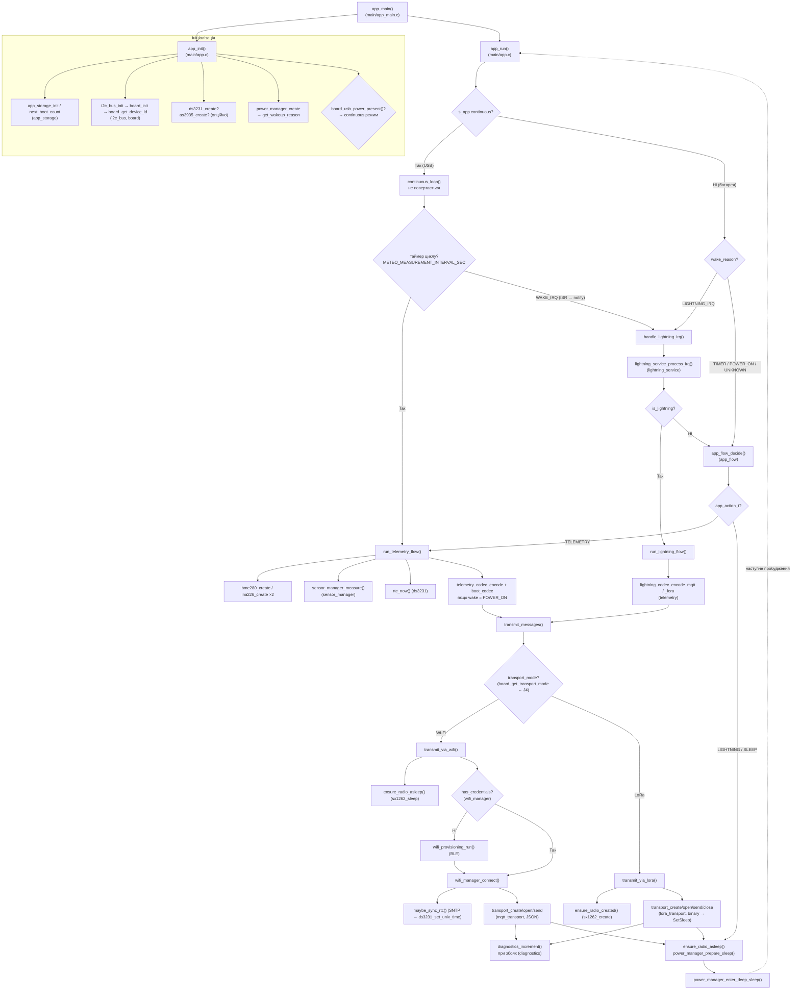
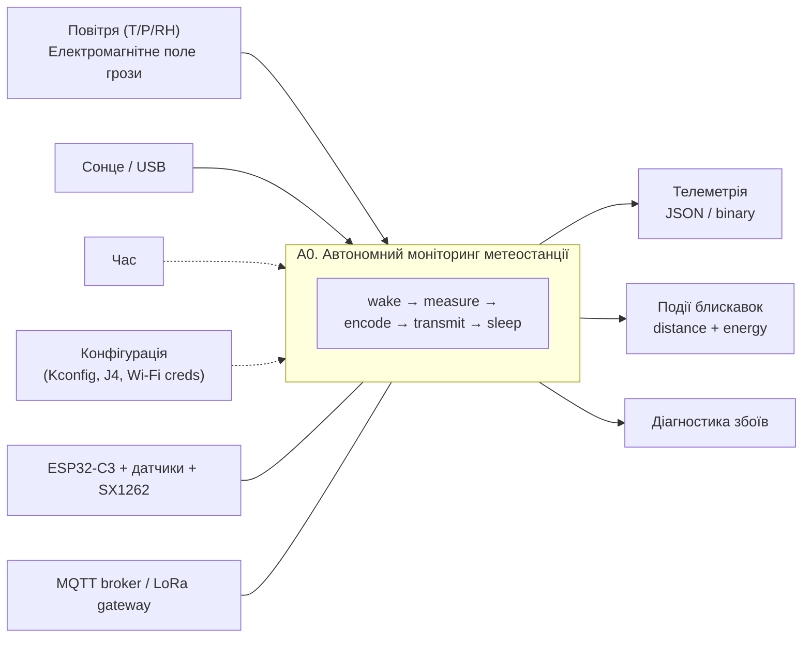
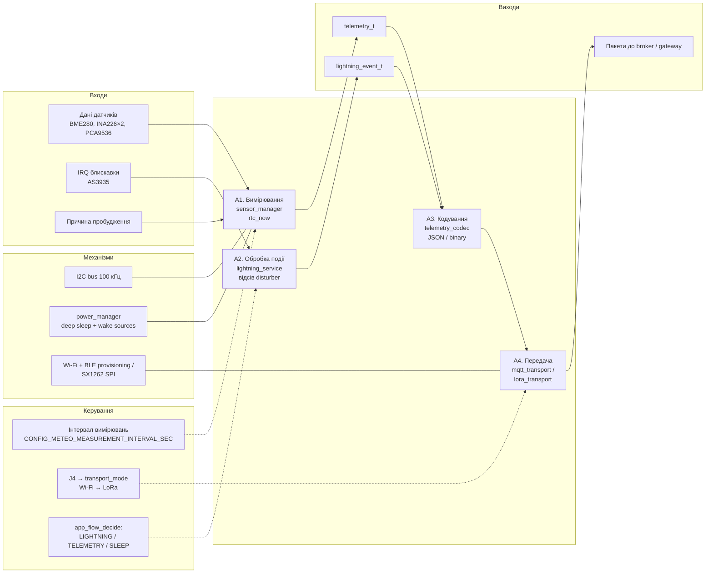
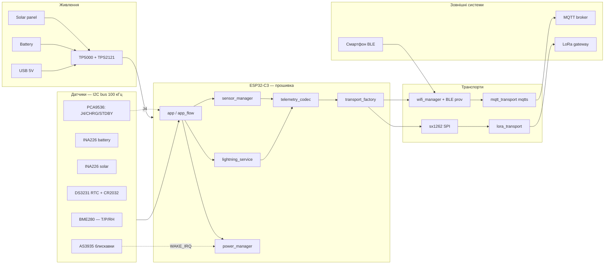

# Діаграми прошивки метеостанції

Діаграми у форматі [Mermaid](https://mermaid.js.org/) — рендеряться в GitHub,
VS Code (розширення Mermaid) та на mermaid.live. Усі вузли відповідають
реальним функціям і компонентам коду — діаграми можна використовувати для
навігації репозиторієм.

## 1. Діаграма розгалуження — дерево викликів функцій

Ієрархія викликів від `app_main()` до драйверів. Кожна гілка — це окремий
сценарій: ініціалізація, телеметрія, блискавка, передача. У дужках — файл.

## 2. Функціональна діаграма (IDEF0)

Декомпозиція головної функції системи. Нотація IDEF0:
**входи** — зліва, **виходи** — справа, **керування** — зверху,
**механізми** (чим виконується) — знизу.

### A0. Контекстна діаграма

### A0-декомпозиція. Функції A1–A4

## 3. Функціональна діаграма системи (блокова)

## Легенда потоків даних

| Потік | Формат | Частота | Код |
| ----- | ------ | ------- | --- |
| Телеметрія | JSON (MQTT) / binary (LoRa) | `CONFIG_METEO_MEASUREMENT_INTERVAL_SEC` | `run_telemetry_flow()` |
| BOOT-повідомлення | JSON / binary | лише POWER_ON | `boot_codec_encode_*` |
| Подія блискавки | JSON / binary | негайно, WAKE_IRQ | `run_lightning_flow()` |
| RTC синхронізація | SNTP → DS3231 | коли час невалідний | `maybe_sync_rtc()` |
